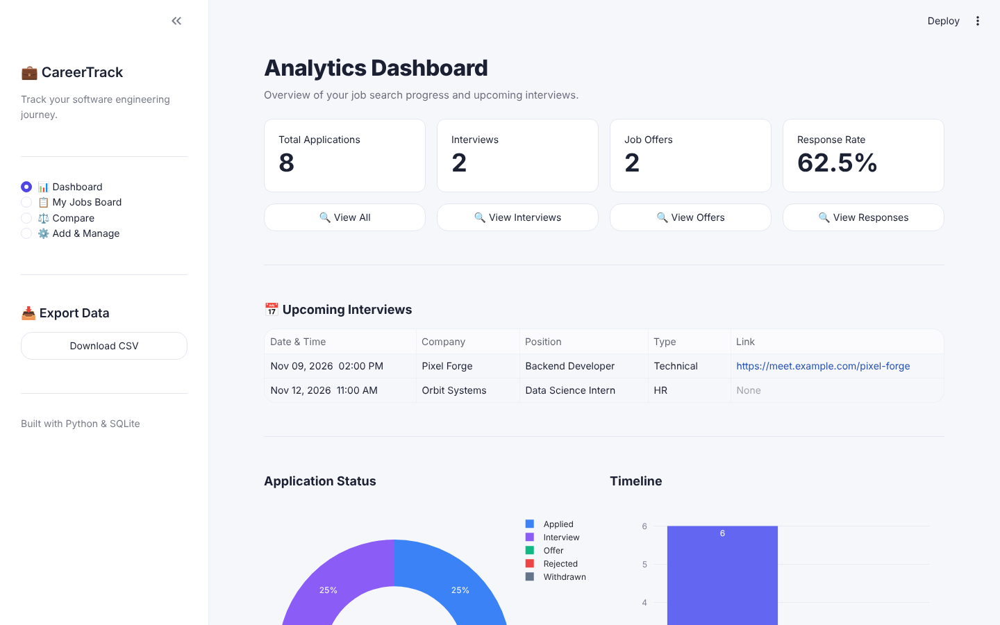
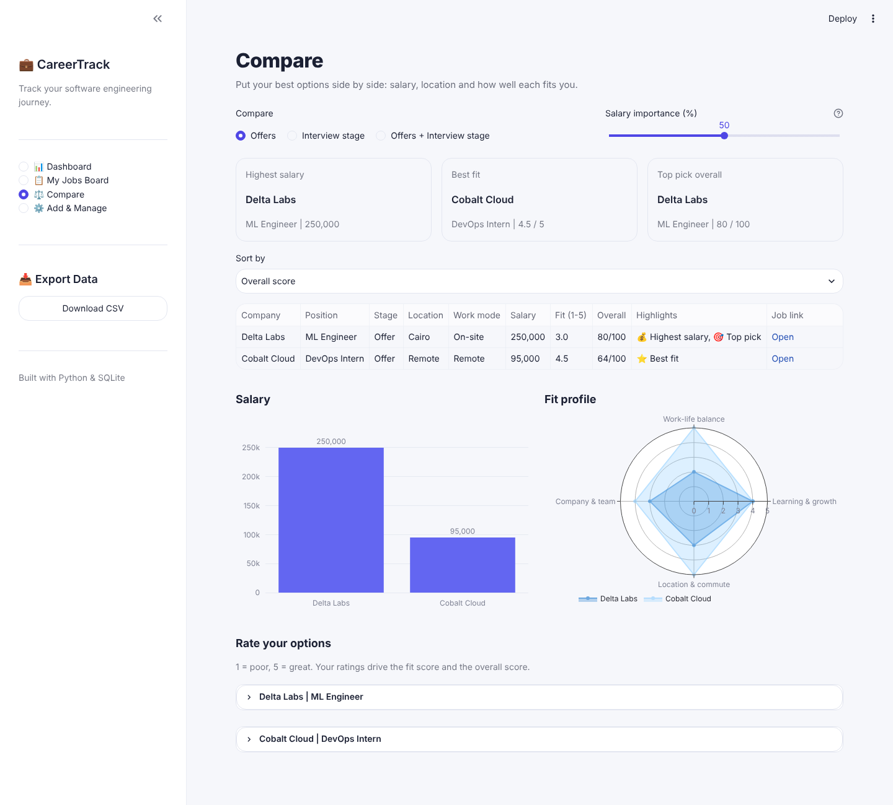
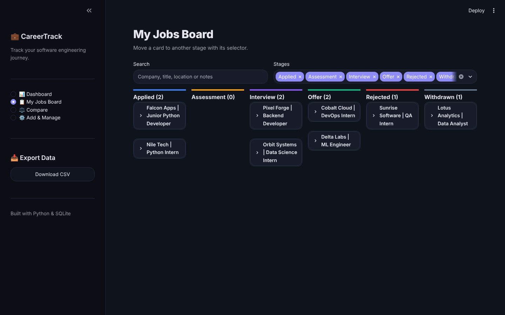

# CareerTrack: Job Application Tracker

[](https://github.com/Mohamed-Magdy-one/job-tracker/actions)


**Live demo: https://magdy-job-tracker.streamlit.app/**

The public demo is open to everyone and uses sample data, so changes you make there are not kept.

A web app for tracking job and internship applications in one place: where you applied, what stage each
application is at, when your interviews are, and how your job search is going overall. Everything is stored in a
single local SQLite database, with no account or cloud service needed.

## Why I built this

I apply to a lot of jobs and internships on LinkedIn, and I kept losing track of them. A few days later I could not
remember which roles I had applied to, and searching my email for confirmations was slow and frustrating.

I wanted one place where every application lives, with the link to the posting, its current stage and my interview
dates, presented in a clean way. On top of that, I wanted to analyse the data: see how my search is going, and when
more than one offer comes in, compare them by salary and by how well each role fits me, so I can choose with
confidence. CareerTrack is that tool, including a Compare page built for exactly that decision.

## Screenshots

| Dashboard | Compare offers |
|---|---|
|  |  |

Kanban board in dark mode:



## Features

- **Dashboard**: totals, response rate, status distribution chart, applications per month, and upcoming interviews
  with an in-app reminder for interviews in the next 48 hours.
- **Kanban board**: one column per stage (Applied, Assessment, Interview, Offer, Rejected, Withdrawn). Move a card
  to another stage from the card itself.
- **Compare page**: put your offers, or the jobs that reached the interview stage, side by side by salary,
  location and work mode. Rate each option from 1 to 5 on learning, work-life balance, company and location, and
  the page shows the highest salary, the best fit and an overall pick. A slider sets how much salary matters to you.
  Salaries typed as `15k` or `15,000 - 20,000 EGP` are parsed, so they can be compared too.
- **Search and filters**: search by company, title, location or notes, and filter by stage.
- **Full CRUD**: add and edit every field (location, job type, work mode, salary, job link, notes), with delete confirmation.
- **Interview scheduling**: attach interviews (type, date, meeting link) to an application. Scheduling one moves an
  early-stage application to *Interview* and never downgrades an *Offer* or *Rejected*.
- **Salary formatting**: numbers are formatted with thousands separators as you type (`90000` becomes `90,000`).
- **CSV export** of all applications.
- **Light and dark themes** that follow your system setting and can be switched from the app menu.

## Tech stack

Python 3.12, Streamlit, SQLite (`sqlite3`), pandas, Plotly, pytest, Ruff, Docker, GitHub Actions.

## Getting started

```bash
git clone https://github.com/Mohamed-Magdy-one/job-tracker.git
cd job-tracker

python -m venv .venv
.venv\Scripts\activate          # Windows
# source .venv/bin/activate     # macOS / Linux

pip install -r requirements.txt
streamlit run app.py
```

The database is created automatically in `data/job_tracker.db` on first run. To try the app with sample data:

```bash
python -m tracker.seed
```

## Running the tests

```bash
pytest
```

The suite uses a temporary database for every test, so your real data is never touched. It covers the service
layer, analytics, offer scoring, and an end-to-end UI test that drives the real Streamlit app (board, search, edit, delete).

## Docker

```bash
docker build -t job-tracker .
docker run -p 8501:8501 -v job-tracker-data:/app/data job-tracker
```

Then open http://localhost:8501. Set `JOB_TRACKER_DEMO=1` to start with sample data.

## Project structure

```
app.py              Streamlit UI (dashboard, board, add/manage)
views/compare.py    Compare page (Streamlit)
tracker/
  database.py       connection helper and schema creation
  applications.py   CRUD, validation, filtering, salary normalisation
  interviews.py     interview scheduling and status promotion
  comparison.py     salary parsing, ratings and the offer score
  analytics.py      dashboard queries
  seed.py           demo data
tests/              pytest suite (isolated temp database per test)
.github/workflows/  CI: lint (Ruff) + tests on every push
```

## Design notes

- **Service layer separated from the UI**, so business rules can be tested without Streamlit.
- **Parameterised SQL everywhere**, with a `CHECK` constraint on status, foreign keys enabled and
  `ON DELETE CASCADE` for interviews.
- **A transparent score**: salary (relative to the best option) mixed with your own 1-5 ratings, using a weight you
  control, implemented as plain functions with tests.
- **One `db_session()` context manager** commits on success, rolls back on error and always closes the connection.
- **Regression tests for real bugs**, for example an ISO-timestamp comparison that kept past interviews listed as upcoming.

## Roadmap

- [x] Offer comparison by salary, location and a personal fit score
- [ ] Offer deadlines with reminders
- [ ] Currency and pay-period normalisation when comparing salaries
- [ ] Status history for a real application funnel
- [ ] Follow-up reminders for applications with no response
- [ ] Export interviews to a calendar (`.ics`)
- [ ] CSV import
- [ ] Wishlist stage

## License

MIT. See [LICENSE](LICENSE).
